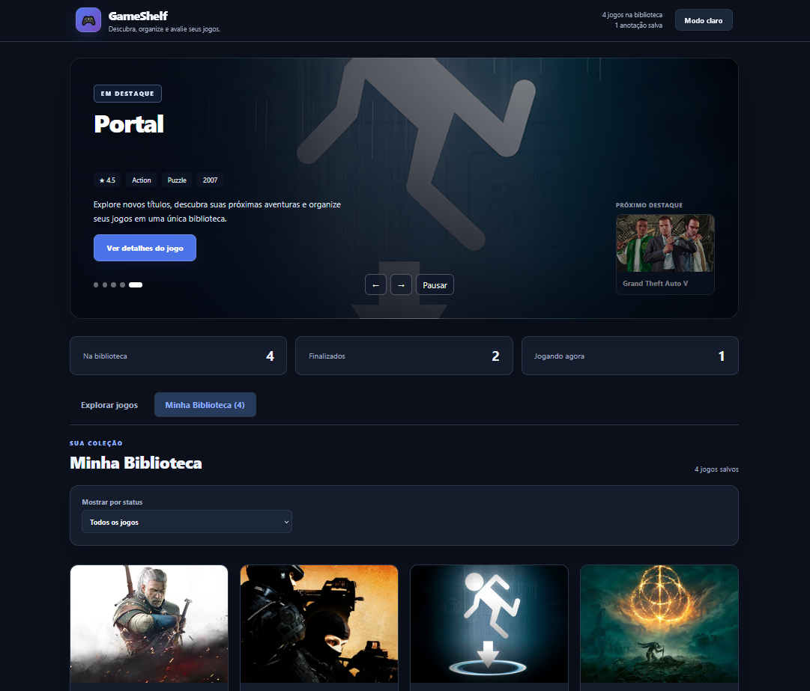

# GameShelf

Aplicação desenvolvida com React e TypeScript para pesquisar jogos, visualizar informações e organizar uma biblioteca pessoal.

O projeto utiliza a API da RAWG para buscar jogos e carregar seus detalhes. As informações da biblioteca, avaliações e anotações são salvas no navegador usando localStorage.

### Funcionalidades

- Buscar jogos usando a API da RAWG.
- Exibir jogos em destaque em um carrossel automático.
- Navegar manualmente entre os destaques.
- Filtrar jogos por gênero, plataforma e status.
- Abrir um modal com detalhes de cada jogo.
- Exibir informações como nome, imagem, nota, lançamento e plataformas.
- Adicionar jogos à biblioteca pessoal.
- Organizar jogos por status: quero jogar, jogando, finalizado, abandonado ou favorito.
- Avaliar jogos finalizados com nota de 1 a 5 estrelas.
- Criar anotações pessoais sobre os jogos.
- Alternar entre tema claro e escuro.
- Salvar biblioteca, avaliações e anotações no localStorage.
- Layout responsivo para computadores, tablets e celulares.

### Tecnologias usadas

- React
- TypeScript
- CSS
- Vite
- RAWG API
- Vercel Functions
- localStorage

### Como rodar o projeto

Primeiro, instale as dependências:

```bash
npm install
```

O projeto utiliza uma função de servidor para acessar a API da RAWG sem expor a chave no navegador.

Para executar localmente, é necessário ter uma chave da RAWG e configurar a variável de ambiente `RAWG_API_KEY`.

Com o projeto vinculado à Vercel e a variável configurada, execute:

```bash
npx vercel dev
```

A aplicação ficará disponível no endereço informado pelo terminal.

O comando `npm run dev` inicia apenas o Vite, sem executar a função `/api/games`.

### Build e verificação

Para gerar a versão de produção:

```bash
npm run build
```

Para verificar o código com ESLint:

```bash
npm run lint
```

### Armazenamento

A biblioteca e as anotações ficam salvas no localStorage do navegador.

Por isso, os dados não são sincronizados entre dispositivos e podem ser perdidos caso o armazenamento do navegador seja apagado.

### Status

Projeto finalizado para o portfólio.

### Deploy

https://gameshelf-amber.vercel.app/

### Screenshot



### Autor

Feito por Gabriel Henrique.